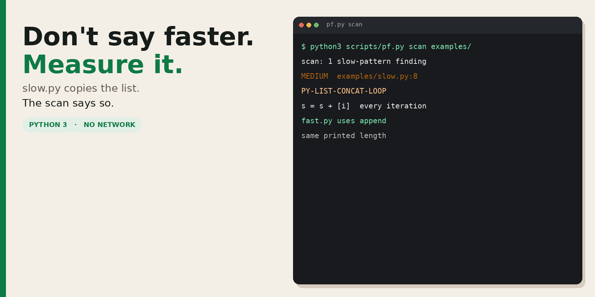
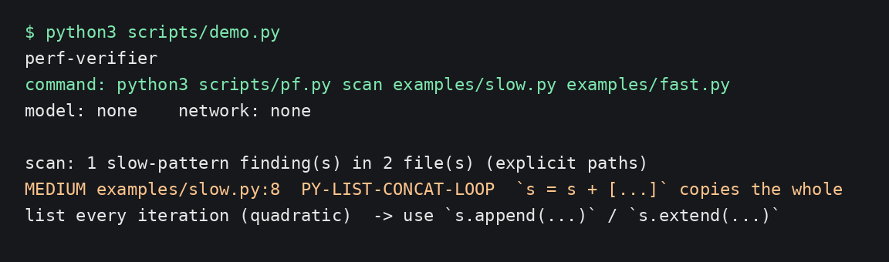

# perf-verifier

Don't call it faster until something measured it.

<p align="center">
  
</p>

[`slow.py`](examples/slow.py) rebuilds a list on every pass. [`fast.py`](examples/fast.py) appends. Same printed length. The script flags the slow one. It does not import a network library.

```bash
npx skills add David-Florian2013/perf-verifier -g -a '*' -y
```

## See it run

No model is called. This is a scan, not a timer.

<p align="center">
  
</p>

```text
$ python3 scripts/demo.py
perf-verifier
command: python3 scripts/pf.py scan examples/slow.py examples/fast.py
model: none    network: none

scan: 1 slow-pattern finding(s) in 2 file(s) (explicit paths)
  MEDIUM examples/slow.py:8  PY-LIST-CONCAT-LOOP  `s = s + [...]` copies the whole list every iteration (quadratic)  -> use `s.append(...)` / `s.extend(...)`
```

A finding is a pattern. It is not a measured speedup. `fast.py` is the shape the finding points at. To time them on your machine:

```bash
python3 scripts/pf.py compare --runs 5 --budget 8 \
  --a 'python3 examples/slow.py 4000' \
  --b 'python3 examples/fast.py 4000' \
  --expect faster
```

The milliseconds change every run, so they are not in the transcript CI checks. Only `FASTER` from that command supports saying "faster".

[](https://github.com/David-Florian2013/perf-verifier/actions/workflows/ci.yml)
[](LICENSE)
[](https://github.com/David-Florian2013/perf-verifier/releases)

## Install

Every agent the [skills CLI](https://github.com/vercel-labs/skills) knows:

```bash
npx skills add David-Florian2013/perf-verifier -g -a '*' -y
```

One agent:

```bash
npx skills add David-Florian2013/perf-verifier -g -a claude-code -y
npx skills add David-Florian2013/perf-verifier -g -a codex -y
npx skills add David-Florian2013/perf-verifier -g -a cursor -y
```

`./install.sh` copies `SKILL.md` and `scripts/pf.py` into `~/.claude/skills/perf-verifier`. CI runs that against an empty directory.

GitHub CLI 2.90.0 or newer:

```bash
gh skill install David-Florian2013/perf-verifier perf-verifier --agent claude-code --scope user
```

Or download `perf-verifier.skill` from the [latest release](https://github.com/David-Florian2013/perf-verifier/releases/latest). It is a zip. Unzip it into the skills folder for the agent you use.

## What you get

| File | What it is |
|---|---|
| [`SKILL.md`](SKILL.md) | When to scan, profile, and compare, and which words may follow which result |
| [`scripts/pf.py`](scripts/pf.py) | `scan`, `bench`, `profile`, `scale`, `compare`, `check` |
| [`examples/slow.py`](examples/slow.py) | `s = s + [i]` inside the loop |
| [`examples/fast.py`](examples/fast.py) | `s.append(i)` |

Needs Python 3. No third-party package. `profile` runs on Python and Node commands. `bench`, `scale` and `compare` run any command.

## Limits

- The scan list is in `pf.py`. A hit is a hypothesis. The skill says to act on it only when it sits on the profiled hot path.
- This repo does not cite a rate of false speedups. There is no study number here.
- The two examples are fixtures. They are not a trace from a model.
- Compare uses a budget. Few runs means a weak test, and the script says so.
- Nothing here can force the agent to run the script. The instruction says to. The script is the part you can re-run.

## Claude Code plugin

```text
/plugin marketplace add David-Florian2013/perf-verifier
/plugin install perf-verifier@perf-verifier
```

`./install.sh` is the path CI checks.

## License

[MIT](LICENSE).
